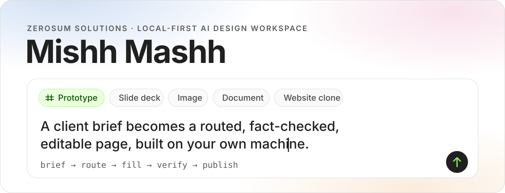
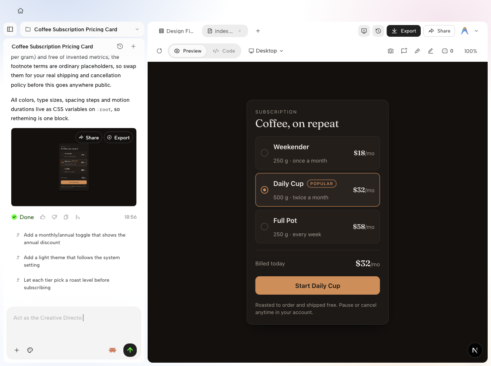
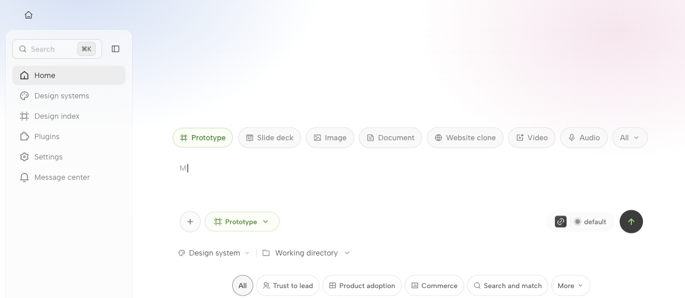
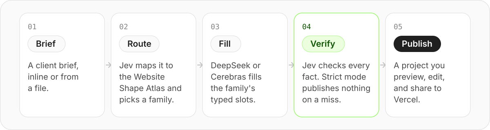

<p align="center">
  
</p>

<p align="center"><b>English</b></p>

# Mish!

**Mish!** (formerly Mishh Mashh) is the design workspace ZeroSum Solutions uses to deliver client work. You write a brief. An AI agent on your own machine makes the design. The result stays in a project where you preview it, edit it, and share it.

This is the public repository. It is a modified fork of an Apache-2.0 project. See [License](#license).

Licensed and third-party content (paid component kits, reference studies, scraped catalogues, fan art) is **not** in this repository. It will be installed separately as private packs through the pack system ([`docs/packs.md`](docs/packs.md)). Features that depend on that content show as unavailable until a pack is installed.

<p align="center">
  
  <br>
  <sub>A project after one run: the conversation on the left, the generated page on the right.</sub>
</p>

## Contents

- [What it does](#what-it-does)
- [Status](#status)
- [How an agency build works](#how-an-agency-build-works)
- [Run it locally](#run-it-locally)
- [Repository map](#repository-map)
- [Documentation](#documentation)
- [How we work](#how-we-work)
- [License](#license)

## What it does

| Part | What it gives you |
|---|---|
| **Web app** (`apps/web`) | Home, where you write a brief and choose the kind of output. Projects, where you review, edit and share results. |
| **Daemon** (`apps/daemon`) | Runs the agents on your machine, keeps projects and files, and serves the `od` command line. |
| **Agency build** | Turns a client brief into a checked website page. This is the part ZeroSum added. |
| **Local agents** | Uses the agent CLI you already have (Claude Code, Codex, Gemini and others). When one is installed and signed in, it is the first choice on the welcome screen. |

Home offers prototypes, slide decks, images, documents, website clones, video and audio. Project chat also supports explicit workspace context; see [composer workspace context](docs/architecture.md#composer-workspace-context) for folder access and queued draft behavior.

Home remembers the project owner, type, sort order and Archived toggle in this
browser for each workspace member and project collection. Local mode keeps a
separate set of preferences for each collection. Clear filters keeps
the chosen sort order. If browser storage is unavailable, the controls still
work for the current visit. Escape closes a slide deck opened in a new tab.

<p align="center">
  
  <br>
  <sub>Home: choose the kind of output, write the brief, then pick a design system and a working directory.</sub>
</p>

## Status

Updated 2026-09-23.

| Area | State |
|---|---|
| Languages | English only. |
| Design systems | One: **Neutral Product**, our own. It is the default. Its status is `candidate`, not `promoted`: the checks in [`QUALITY-STANDARD.md`](docs/design-systems/QUALITY-STANDARD.md) found work left to do. The five brand-copied systems from upstream were removed. |
| Agency build | Works end to end: route, fill, verify, publish. Seven site families and three page kinds (marketing site, app shell, CRM dashboard). |
| Desktop app | Not ready to give to anyone. See [Limits](#limits). |
| CI | GitHub Actions on GitHub-hosted runners validates pull requests. |

### Limits

- A desktop build must not go to anyone yet. The open items are in [`docs/legal/LICENSE-COMPLIANCE.md`](docs/legal/LICENSE-COMPLIANCE.md): license files in the installer, the closed-license `vela` CLI, the installer name, and the upstream cloud sign-in card.
- Internal package scopes, the `od` command and the `OD_*` variables keep their upstream names. They are internal, and we keep them for compatibility.

## How an agency build works

<p align="center">
  
</p>

1. **Brief.** Give the client brief inline or from a file.
2. **Route.** One Jev (TypeSafe) request places the brief on the Website Shape Atlas and picks a family package. If no family fits, the build stops and says why. It does not guess.
3. **Fill.** DeepSeek (default) or Cerebras fills the family's typed content slots. A trusted compiler turns the slots into HTML. The model does not write layout or CSS.
4. **Verify.** Jev checks each fact against the brief. In `strict` mode (the default) nothing is published if a fact is invented, too long, or missing.
5. **Publish.** The page becomes a project. Preview it, edit the text, and share it to Vercel.

Start a build from **Design index → Route → Build**, or from the CLI:

```bash
pnpm exec od agency route --brief "A family dental practice in Riverbend"   # route only
pnpm exec od agency build --brief "A family dental practice in Riverbend" --name "Riverbend Dental" # full build
pnpm exec od agency build --from "$BUILD_ID"                                # rebuild from a saved build; set BUILD_ID first
```

Routing and verification need a Jev key: `od agency config set --key-stdin`. `od agency --help` lists every flag and exit code. Details: [`packages/agency-fast-lane/README.md`](packages/agency-fast-lane/README.md) and [`docs/agency-site.md`](docs/agency-site.md).

## Run it locally

**New teammates:** run `sh scripts/team-setup.sh`. It checks prerequisites, installs, builds and starts the web app in one command. See [`QUICKSTART.md` → Team setup](QUICKSTART.md#team-setup).

You need Node `~24` and pnpm `10.33.2` (Corepack picks the pinned pnpm).

```bash
corepack pnpm install
pnpm tools-dev start web --daemon-port 7456 --web-port 3000
```

Open <http://127.0.0.1:3000>. [`QUICKSTART.md`](QUICKSTART.md) covers other setups.

## Repository map

| Path | What it holds |
|---|---|
| `apps/web` | The Next.js web app |
| `apps/daemon` | The local daemon, the `/api/*` routes and the `od` CLI |
| `apps/desktop`, `apps/packaged` | The Electron shell and the packaged runtime |
| `packages/agency-fast-lane` | The agency build: route, fill, verify |
| `packages/contracts` | Types shared by the web app and the daemon |
| `plugins/_official/` | Bundled plugins, including the agency family packages |
| `design-systems/` | Design-system packages (Neutral Product) and their schema |
| `design-templates/`, `skills/` | Render templates and agent skills |
| `tools/dev`, `tools/pack` | The local lifecycle and packaged builds |
| `e2e/` | End-to-end and Playwright UI tests |

## Documentation

| Read this | When |
|---|---|
| [`AGENTS.md`](AGENTS.md) | Before you change code. It is the source of truth for boundaries, commands and checks. |
| [`CONTRIBUTING.md`](CONTRIBUTING.md) | Before your first pull request. |
| [`CONTEXT.md`](CONTEXT.md) | To learn the domain words. |
| [`docs/architecture.md`](docs/architecture.md) | To understand how the parts connect. |
| [`docs/design-systems/QUALITY-STANDARD.md`](docs/design-systems/QUALITY-STANDARD.md) | Before you add or change a design system. |
| [`docs/FORK-PIN.md`](docs/FORK-PIN.md) | Before you take a change from upstream. |
| [`docs/legal/LICENSE-COMPLIANCE.md`](docs/legal/LICENSE-COMPLIANCE.md) | Before you give a build to anyone. |
| [`PRIVACY.md`](PRIVACY.md) | To see what data the app sends and when. |
| [`docs/testing/diagnostics-environment.md`](docs/testing/diagnostics-environment.md#local-download-policy) | Before saving or sharing a diagnostics bundle; local download, redaction and collection limits. |
| [`TRANSLATIONS.md`](TRANSLATIONS.md) | Before you add or change UI text. |

## How we work

- **Fork policy.** This is a hard-pinned, cherry-pick-only fork of upstream commit `73953213a` (release v0.22.2). We take single upstream commits, never merges. Each one is logged in [`docs/FORK-PIN.md`](docs/FORK-PIN.md).
- **Changes.** Every change goes through a pull request with green CI and is squash-merged. Details are in [`CONTRIBUTING.md`](CONTRIBUTING.md).
- **UI text.** Every new key needs English.

## License

Mish! is a modified version of an upstream project licensed under the Apache License 2.0. See [`LICENSE`](LICENSE) and [`NOTICE`](NOTICE). ZeroSum Solutions changed the product name, removed upstream community links, removed brand-copied design systems, kept two languages, and turned off most upstream network calls (the rest are listed in [`LICENSE-COMPLIANCE.md`](docs/legal/LICENSE-COMPLIANCE.md)). This repository starts from a snapshot of ZeroSum's private working repository; see [`NOTICE`](NOTICE).

Upstream names and logos belong to their owners. This product is not affiliated with or endorsed by the upstream project or its owners. Bundled components with their own `LICENSE` files keep those licenses, for example [`skills/web-clone/`](skills/web-clone/) (MIT).
